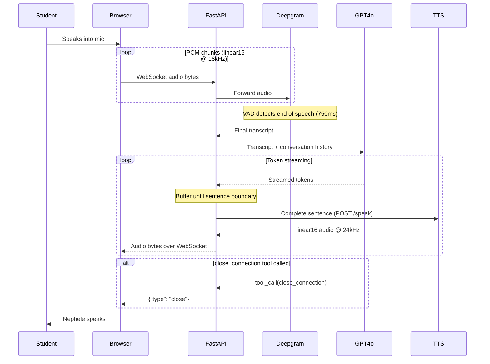

# Nephele: AI College Placement Companion

Nephele is a real-time **voice AI companion** built to guide students through their college placement journey. Ask her about interview prep, resume tips, company insights, or anything placement-related — she listens, thinks, and talks back in real-time.

Built by **The Cloud PeP Students** — Tech Leads: **Saravana & Joshua**

---

## What is Nephele?

Nephele is a **real-time conversational voice assistant** designed for college placement support. Students speak naturally, and Nephele responds as a knowledgeable, always-available placement companion — with streamed speech recognition, streamed LLM responses, and streamed TTS audio. Actual latency depends on the network and providers.

---

## Architecture

```
┌──────────────────────────────────────────┐
│           FRONTEND  (React + Vite)        │
│                                          │
│   App.tsx                                │
│   └── VoiceOverlay.tsx                   │
│       ├── Captures mic audio (PCM 16kHz) │
│       ├── Streams audio over WebSocket   │
│       ├── Receives & plays TTS audio     │
│       └── Renders live transcript        │
└──────────────────┬───────────────────────┘
                   │  WebSocket  /ws/voice
                   ▼
┌──────────────────────────────────────────┐
│           BACKEND  (FastAPI)              │
│                                          │
│   main.py                                │
│   └── routes/voice_routes.py             │
│       ├── Deepgram Nova-2  (STT)         │
│       ├── OpenAI GPT-4o-mini (LLM)       │
│       └── Deepgram Aura TTS             │
└───────┬──────────────────────────────────┘
        │                  │
        ▼                  ▼
  Deepgram API        OpenAI API
  (STT + TTS)         (GPT-4o-mini)
```

---

## Voice Flow



---

## Project Structure

```
production/
├── backend/
│   ├── main.py                  # FastAPI app entry point, CORS, router registration
│   ├── requirements.txt         # Python dependencies
│   └── routes/
│       └── voice_routes.py      # WebSocket /ws/voice — STT → LLM → TTS pipeline
│
└── frontend/
    ├── index.html               # App entry point
    └── src/
        ├── App.tsx              # Root component — renders VoiceOverlay
        ├── config.ts            # WS_BASE_URL and environment config
        ├── components/
        │   └── VoiceOverlay.tsx # Full voice UI: mic capture, WS, PCM playback
        └── pages/               # Additional pages (if any)
```

---

## Technology Stack

| Layer    | Technology                     | Role                                     |
|----------|--------------------------------|------------------------------------------|
| Frontend | React 19, Vite 8, TypeScript     | UI, mic capture, PCM audio playback      |
| Backend  | Python FastAPI (ASGI)          | WebSocket server, pipeline orchestration |
| STT      | Deepgram Nova-2 (WebSocket)    | Real-time speech-to-text with VAD        |
| LLM      | OpenAI GPT-4o-mini (streaming) | Conversational AI with function calling  |
| TTS      | Deepgram Aura Asteria (HTTP)   | Sentence-level text-to-speech            |

---

## Getting Started

### Prerequisites

- Python 3.10+ (3.11+ recommended)
- Node.js 22.12+
- OpenAI API Key
- Deepgram API Key


### Local setup

```sh
# From the repository root. Never commit real .env files.
python3 -m venv .venv
. .venv/bin/activate
pip install -r backend/requirements.txt
cp backend/.env.example backend/.env
# Fill OPENAI_API_KEY and DEEPGRAM_API_KEY in backend/.env locally.
cd backend
uvicorn main:app --host 0.0.0.0 --port 8000
```

In a second terminal:

```sh
cd frontend
npm ci
cp .env.example .env
npm run dev
```

Open `http://localhost:5173`. Click **Start a conversation** and grant microphone
access. The microphone does not start automatically on page load. The blue robot artwork is
used as the responsive hero; the existing green-face video remains available under
"View Nephele's original animation" without autoplay or cropping. The previous
always-on browser wake-word listener has been removed: browser speech recognition
was inconsistent and could keep asking for microphone access after a call ended.
End the conversation to stop all microphone tracks and scheduled playback. Chrome
or Edge on HTTPS (or localhost) is recommended; other browsers need MediaDevices,
AudioWorklet and WebSocket support.

`GET /health` starts without provider keys and reports `voice_configured: false`
until both are set. This reports configuration presence, not valid credentials or
provider availability. A voice call without keys returns an actionable error rather
than crashing the app at import time. Provider failures are shown in the UI.

### Existing Render and Vercel setup

No dashboard settings are changed by this patch. There are no checked-in
`render.yaml` or `vercel.json` files. Verify the following **before merging**:

| Service | Required setting |
| --- | --- |
| Render | Root directory `backend`; install `pip install -r requirements.txt` |
| Render | Start `uvicorn main:app --host 0.0.0.0 --port $PORT` |
| Render | `OPENAI_API_KEY` and `DEEPGRAM_API_KEY` set privately |
| Render | `ALLOWED_ORIGINS` contains the exact Vercel/custom frontend origin(s), comma-separated, without trailing slashes |
| Render | Health path `/health`; WebSocket connections supported |
| Vercel | Root directory `frontend`; build `npm run build`; output `dist`; Node 22.12+ |
| Vercel | Public build variable `VITE_WS_URL=https://YOUR-BACKEND.onrender.com` |

`VITE_WS_URL` is an origin (optionally a base path), **not** `/ws/voice`. HTTP(S)
origins are converted to WS(S). A hosted frontend will not silently connect to
`localhost`. HTTPS pages reject an insecure backend. Vite substitutes variables at
build time, so changing this value requires a rebuild. Never put provider secrets
in a `VITE_` variable. Both preview and production frontend origins must be allowed
explicitly on the backend if you want voice to work on both.

**Verification boundary:** a clean install, production frontend build, lint, unit
regressions, mocked browser voice flows and local keyless backend startup can be
tested without credentials. They do not prove a paid Deepgram/OpenAI voice call,
Render cold-start behavior, or current deployed dashboard values. A first request
to a sleeping service may time out; retry once it is awake.

### Tests

```sh
cd frontend
npm ci
npm run build
npm run lint
npm test
npm audit

cd ../backend
python -m unittest discover -s tests -v
```

Optional Chromium browser regression (no paid API calls):

```sh
# From frontend/, install Playwright outside the app dependency tree, for example:
npm install --prefix /tmp/nephele-browser playwright
PLAYWRIGHT_MODULE=/tmp/nephele-browser/node_modules/playwright/index.mjs node tests/browser.mjs
# CHROME_PATH can override /usr/bin/google-chrome.
```

The tests cover production URL validation, PCM sample rates and odd byte splits,
missing provider keys, origin checks, cancellation while awaiting speech,
provider failures and history bounds. Browser regressions cover desktop/mobile,
mocked microphone capture, streamed messages/audio, reconnect, errors and denied
microphone permission. They do not send speech to external providers.

### Voice protocol and operational limits

The endpoint stays `/ws/voice`. The server sends `ready` after speech recognition
connects; only then does the frontend forward PCM. JSON events include `user_text`,
`text`, `interrupted`, `audio_complete`, `error`, and `close`. Binary audio is
headerless 24kHz mono signed little-endian PCM; capture is resampled to 16kHz.
Speech-start events interrupt the previous response. Final transcript segments are
combined until Deepgram marks the utterance complete.

Conversation text stays in connection-local memory with a bounded history; neither
this app nor its UI writes transcripts to a database or local storage. External
providers process speech/text under their own policies. Do not share sensitive
information. Calls stop after 15 minutes and may be restarted.

Origin validation is **not authentication or a spending quota**. This remains an
unauthenticated voice endpoint with billable external providers. Before broad public
release, choose authentication/rate limits and provider budgets with the owner.
No authentication system, billing settings, or deployment is added by this cleanup.
`backend/seed_db.py` is an unrelated legacy attendance script referring to a missing
module; it is not used by the voice service and should not be run.
